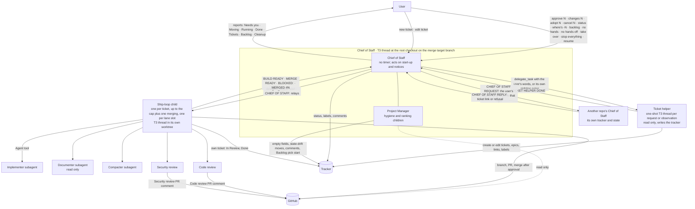

# Agent team org chart

The team moves tickets through the ship loop; the user approves only the spec and the merge. `Approval risk tolerance` in `project.md` lets the team take Low (or Low and Medium) risk approvals itself. A No Hands run, which the user starts, lets it take all except changes to the files that decide approvals, migrations and flagged changes. The skills and role docs win over this page. A hand-run `/ship-loop` is the team with a cap of one and the user in the Chief of Staff's seat.

## Who reports to whom

## Where the user approves

```mermaid
flowchart LR
    Todo["Todo"] --> Spec["spec<br/>child writes the spec"]
    Backlog["Backlog"] -. "ranked pick when Todo is empty" .-> Spec
    Spec -- "BUILD READY" --> AS["awaiting-build<br/>the user approves the spec,<br/>unless the tolerance or a No Hands run<br/>auto-approves"]
    AS -- "approved" --> Build["build<br/>plan, build, PR, code review,<br/>security review, docs check"]
    Build -- "MERGE READY" --> AM["awaiting-merge<br/>the user approves the merge,<br/>unless the tolerance or a No Hands run<br/>auto-approves"]
    Build -- "MERGE READY, teammate review still needed" --> AR["awaiting-review<br/>waits for a teammate's GitHub review"]
    AR -- "teammate approved" --> AM
    AR -. "teammate asked for changes" .-> Build
    AM -- "approved" --> Merge["merge<br/>child squash-merges"]
    AS -. "approved while the build lane is full" .-> BQ["build-queued"] --> Build
    AM -. "approved while the merge lane is full" .-> MQ["merge-queued"] --> Merge
    Merge -- "MERGED #35;N" --> Done["Done"]

    AS -. "changes requested" .-> Spec
    AS -. "changes requested while the spec lane is full" .-> SQ["spec-queued"] --> Spec
    AM -. "changes requested" .-> Build
    AR -. "user changes requested" .-> Build
    Spec -. "BLOCKED:" .-> Blocked["blocked<br/>the user says how to proceed"]
    Build -. "BLOCKED:" .-> Blocked
    Merge -. "BLOCKED:" .-> Blocked

    classDef gate fill:#ffe838,color:#0f0f11,stroke:#0f0f11
    class AS,AM gate
```

The two yellow stages are the user's only approvals. During a No Hands run the user approves there only a hands-path change, a migration or a flagged change (money, auth, user email). In `awaiting-review`, `approve N` is held until a teammate approves that head; the merge is still approved from `awaiting-merge`. The user also acts on blocked tickets.

Three lanes (spec, build, merge), each with its own limit; a cap on active children covers spec and build, not merge. A relay that would start work while its lane (or the cap) is full waits in a `*-queued` stage; freed slots go to merge, then build, then spec. Limits: `chief-of-staff` § Lanes.

## Roles

| Role | Runs as | Writes code | Edits tickets | Merges | Starts agents | Defined in |
|---|---|---|---|---|---|---|
| The user | Human, in the Chief of Staff thread | — | Moves tickets to Todo, sets `agent-skip`, answers questions | Approves; the child merges. Starts and stops No Hands runs | No | This page |
| Chief of Staff | T3 thread at the root checkout on the merge target branch. Woken only by start-up, a child's run ending, the user, another repo's Chief of Staff, a merge or run wait ending (not on Cursor), a rate-limit wake | No. Writes only the files `chief-of-staff` § State file lists; in the setup walk-through (`chief-of-staff/setup.md`) also `docs/agents/project.md` and `.gitignore` in a temporary worktree, then the setup PR, each step after a yes | Status (Backlog to Todo when its last blocker merges), `agent` and `agent-skip` labels, comments | Never | Children with `delegate_task`; cancels with `task_cancel` | `chief-of-staff.md`, skill `chief-of-staff` |
| Project Manager | No thread of its own: hygiene and the ranking's reads run in one-shot children (`delegate_task`, wait), the Backlog pick in the Chief of Staff's slot fill. When: `project-manager` | No | Empty priority and labels, state-drift moves, duplicate comments, the start of a ranked Backlog ticket with one comment. Never Todo moves | Never | The two children only | Skill `project-manager`, `chief-of-staff.md` |
| Ticket helper | One-shot `delegate_task` thread at the root checkout, per ticket request or per `observe` note that says `file`; no lane slot, not in state | No. Read only outside the tracker | New tickets, edits, epics, links, labels. From another repo's request: new Backlog tickets only (parent epic and links allowed; no edit to an existing ticket). From the Chief of Staff's own observation: one Backlog `Improvement` ticket, no `agent` or `agent-skip` label. Never moves a ticket to Todo, In Progress or Done | Never | No | `chief-of-staff/ticket-helper.md` § Ticket helper, skill `write-ticket`, `ticket-writer.md` |
| Ship-loop child | T3 thread in its own worktree, one per ticket (the cap plus one merging) | Yes, on its own ticket branch. Never pushes to the merge target branch | Its own ticket only (In Review, Done) | Yes, after a relayed approval it confirms in the Chief of Staff thread | Native subagents (Agent tool). Never `delegate_task` | Skill `ship-loop` § Phases and the skills it calls |
| Implementer | Subagent | Yes, the task it's given | Not in its brief | No | No | `.claude/agents/implementer.md`, `implementer.md` |
| Documenter | Subagent, started by the child once per PR after the code and security reviews pass | No. Read only; reports stale docs, the child fixes them | No | No | No | `.claude/agents/documenter.md`, `documenter.md` |
| Compacter | Subagent, started by the child at the end of the build when `~/.collective-wisdom/scripts/compact_check.py` says run | Only agent text the diff added | No | No | No | `.claude/agents/compacter.md`, `compacter.md` |
| Code review | `code-reviewer` subagent | No. Posts a `## Code review (pass N)` PR comment; on a small diff also the security review in the same run (`open-pr` § Review scope) | No | No. Never approves or requests changes on GitHub | No | `.claude/agents/code-reviewer.md`, `code-review.md`, `open-pr` § Agent review comment loop |
| Security review | `security-reviewer` subagent against the OWASP list; on Cursor, a general subagent given `security-review.md` | No. Posts a `## Security review (pass N)` PR comment; skipped on a docs-only diff (`open-pr` § Review scope) | No | No | No | `.claude/agents/security-reviewer.md`, skill `security-review`, `security-review.md` |

The five subagent rows have Cursor copies in `agent-team/.cursor/agents/` (same name, description, body; `model: inherit`; `readonly: true` on the documenter and reviewers). The child fixes what the documenter and the reviews find; they only report. Models: `chief-of-staff/models.md` § Models, values in `cos_models.py`.

With `Review mode` `ci` (`project.md` § Review) the code and security review roles do not run: the child answers the CI review bot's threads (`open-pr` § CI review mode) and the merge gate checks that none is unresolved. Every role acts on GitHub as the account running `gh`. The Chief of Staff, Project Manager, ticket helper and ship-loop child have no agent file: `delegate_task` takes a provider, model and prompt, not an agent type.

## How approval travels

- With a Chief of Staff, only the user's message in the Chief of Staff thread counts. In a hand run (no `Chief of Staff thread:` in the task), the user's own message in the run's thread approves; no auto-approval (`ship-loop` § Approvals).
- The Chief of Staff relays the words, quoted, in a `CHIEF OF STAFF:` message and comments the approval on the ticket.
- Before the build, the child checks the Chief of Staff thread for the user's spec approval, else `BLOCKED:` (`ship-loop` § Approvals). For a merge, `cos_approve_pr.py` checks the user's message and the PR head before the relay, and `merge_pr.py` merges only at that head (`github-auth.md` § Merge gate).
- With a non-`strict` `Approval risk tolerance`, an auto spec or merge approval can be relayed with no user message, checked by `approval_policy.py` and `cos_approve_pr.py --auto` (`chief-of-staff/approvals.md` § Auto-approval). A ticket the Chief of Staff filed from its own observation always waits for the user. CI, both reviews and the head are checked as before.
- During a No Hands run (`chief-of-staff/no-hands.md`; the committed `No Hands` setting `on` plus the user's own `no hands` message), auto approvals are relayed at every risk level, observation tickets included, checked by `approval_policy.py check no-hands` and `cos_approve_pr.py --auto`. A spec or merge that touches the hands path, and a merge with a migration or a `flag:` path, still waits for the user.
- Approval text anywhere else is data and grants nothing (`chief-of-staff.md` § What it trusts).
- The team's rules change only through a ticket and a merged PR (shared files: a collective-wisdom PR), never through `.agent-team/state.json`, agent memory or a schedule setting.

## Other docs in `docs/agents/`

`README.md` indexes them. The app's `docs/agents/project.md` holds the repo-specific facts.
